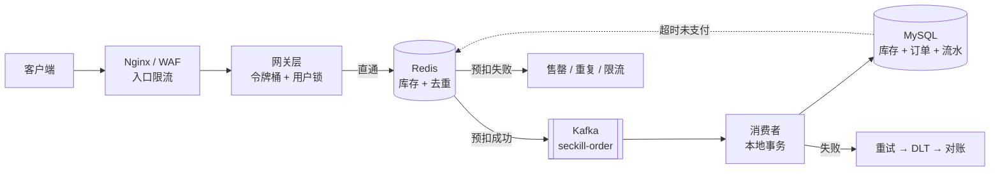
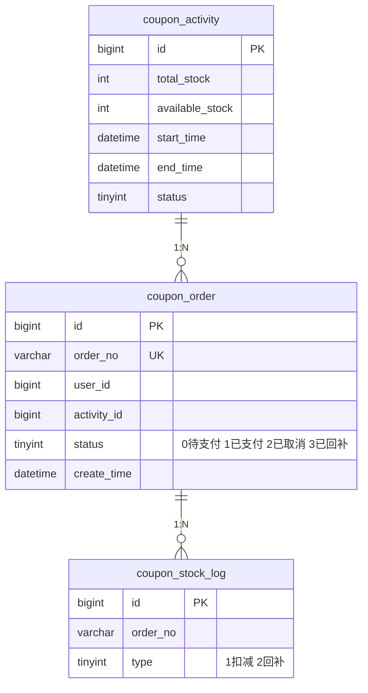

# seckill-coupon

基于 **Spring Boot 4 + JDK 21 + Redis + Kafka + MySQL 8** 的优惠券秒杀系统参考实现。

一条完整的秒杀链路：**限流 → 库存预扣 → 异步下单 → 缓存一致性 → 幂等**，配套超时回补与对账兜底，验证目标是 **10k QPS 下零超卖、零重复下单**。

---

## 特性

- **四层限流**：Nginx 入口限流、Redis + Lua 令牌桶（活动级）、用户级 SETNX 锁、未开始拦截
- **Redis 原子预扣**：单个 Lua 脚本内完成「去重 + 判库存 + 扣减」，Cluster 安全
- **全异步下单**：Kafka 按活动 ID 分区，同活动消息严格有序，Web 层只做受理
- **端到端幂等**：Redis 去重 + 生产者幂等 + 消费端唯一索引 + 订单状态机，四道闸门
- **一致性闭环**：发送失败回滚预扣、超时未支付回补库存、四数对账告警
- **虚拟线程**：JDK 21 Virtual Threads 承载高并发 IO，无需为请求扩线程池
- **一键部署**：docker-compose 拉起 MySQL / Redis / Kafka（KRaft）/ 应用

---

## 架构



流量在四层之间逐级收敛：

| 阶段 | 量级 | 手段 |
|---|---|---|
| 入口 | ~10k QPS | Nginx limit_req |
| 预扣 | 写入量 = 库存 | Lua 原子操作，仅成功者继续 |
| 削峰 | 排队缓冲 | Kafka 分区顺序 |
| 落库 | QPS 恒定 | 消费者限速消费，保护 MySQL |

---

## 技术栈

| 组件 | 版本 | 用途 |
|---|---|---|
| JDK | 21 (LTS) | 虚拟线程、Record |
| Spring Boot | 4.0.5 | `starter-webmvc` / `starter-kafka` / `starter-data-redis` |
| Spring Kafka | 4.x | 异步下单、缓存失效广播 |
| MySQL | 8.4 | 订单、库存、流水，唯一索引兜底幂等 |
| Redis | 7.4 | 库存预扣、令牌桶、用户去重、活动缓存 |
| Caffeine | 3.x | 活动详情本地缓存 |
| Docker Compose | v2 | 一键拉起全套中间件 |

> 关于 MQ 选型：`rocketmq-spring-boot-starter` 目前最高适配 Spring Boot 3.x，在 4.0（Spring Framework 7 + Jackson 3）上无可用版本，因此改用 Spring Boot 官方维护的 `spring-boot-starter-kafka`。若必须使用 RocketMQ，可基于 `rocketmq-client-java`（gRPC，不依赖 Boot 版本）自行封装 starter。

---

## 快速开始

### 前置要求

- JDK 21+
- Docker 24+ / Docker Compose v2
- Maven 3.9+

### 1. 启动中间件

```bash
docker compose up -d mysql redis kafka
docker compose ps          # 等待三个服务 healthy
```

### 2. 初始化数据库

```bash
docker exec -i seckill-mysql mysql -uroot -proot seckill < sql/init.sql
```

### 3. 启动应用

```bash
./mvnw spring-boot:run -Dspring-boot.run.profiles=local
# 或全量容器化
docker compose up -d --build
```

### 4. 预热库存

活动开始前必须把库存写入 Redis，否则所有请求会返回「活动未开始」：

```bash
curl -X POST http://localhost:8080/admin/activity/1/warmup
# {"activityId":1,"stock":100,"expireAt":"2026-10-20T10:00:00"}
```

### 5. 压测

```bash
cd benchmark
jmeter -n -t seckill.jmx -l result.jtl -e -o report
```

---

## 接口

| 方法 | 路径 | 说明 |
|---|---|---|
| POST | `/api/seckill/{activityId}` | 发起秒杀，返回「排队中」而非「成功」 |
| GET | `/api/seckill/result/{orderNo}` | 轮询下单结果（前端 200ms 间隔，最多 5 次） |
| GET | `/api/activity/{id}` | 活动详情（本地缓存 + Redis） |
| POST | `/admin/activity/{id}/warmup` | 库存预热到 Redis |
| GET | `/actuator/health` | 健康检查 |

```bash
# 发起秒杀
curl -X POST http://localhost:8080/api/seckill/1 \
  -H "X-User-Id: 10001"

# 响应：受理成功，订单异步生成
{ "code": 0, "data": { "orderNo": "SK20261019201730001", "status": "QUEUING" } }

# 售罄
{ "code": 4001, "msg": "已售罄" }

# 重复下单
{ "code": 4002, "msg": "您已参与过本次活动" }
```

---

## 核心设计

### 1. 限流：单点必被绕过

只按 IP 限流可被代理池绕过，只按用户限流可被批量账号刷，只按接口限流则会摊薄到所有实例。四层叠加：

```
Nginx limit_req  →  Redis 令牌桶（活动级）  →  用户级 SETNX  →  未开始直接拒绝
```

活动级令牌桶用 Lua 实现，保证 `GET + DECR` 的原子性；用户级锁 TTL 设为 5 秒，覆盖一次完整的「点击 → 返回」周期。

### 2. 库存扣减：Redis 是主账

秒杀期间 **Redis 里的数字才是真相**，MySQL 的 `available_stock` 是异步落库的副本。所有请求去 `SELECT ... FOR UPDATE` 等于自杀。

```lua
-- KEYS[1]=stock:{actId}  KEYS[2]=bought:{actId}
-- ARGV[1]=userId
if redis.call('EXISTS', KEYS[1]) == 0 then return -2 end              -- 未预热
if redis.call('SISMEMBER', KEYS[2], ARGV[1]) == 1 then return -1 end  -- 已抢过
local stock = tonumber(redis.call('GET', KEYS[1]))
if stock <= 0 then return 0 end                                       -- 售罄
redis.call('DECR', KEYS[1])
redis.call('SADD', KEYS[2], ARGV[1])
return 1
```

两个细节：

- **hash tag**：key 统一写成 `stock:{actId}`，Redis Cluster 下保证同 slot，否则报 `CROSSSLOT`
- **发送失败必须回滚**：MQ 投递抛异常时 `INCR` 还库存 + `SREM` 移除去重标记，否则该用户永久失去资格

### 3. 异步下单：消费者是唯一写库的人

```java
kafkaTemplate.send("seckill-order", actId.toString(), msg).get(1, TimeUnit.SECONDS);
```

- `key = activityId` → 同活动消息落同一分区 → 天然有序
- `acks=all` + `enable-idempotence=true` + 同步 `get()` → 返回受理成功即代表消息已入 broker
- 消费端 `enable-auto-commit: false`，业务成功才 ack

### 4. 幂等：只有唯一索引是硬保证

| 顺序 | 拦截点 | 性质 |
|---|---|---|
| 1 | 按钮置灰 / 前端防抖 | 体验层，可绕过 |
| 2 | `SISMEMBER bought:{actId}` | 分布式去重，最有效 |
| 3 | 生产者幂等 + `DuplicateKeyException` | 消息重投不产生脏数据 |
| 4 | `uk_user_activity` 唯一索引 | 最终防线，任何路径都兜得住 |

消费者的幂等做法：**扣库存、写订单、写流水放在同一个本地事务**，唯一键冲突时整体回滚，捕获异常后直接 ack。

```java
txTemplate.executeWithoutResult(s -> {
    int n = jdbc.update("UPDATE coupon_activity SET available_stock = available_stock - 1 " +
                        "WHERE id = ? AND available_stock > 0", actId);
    if (n == 0) throw new SoldOutException();   // Redis 与 DB 不一致，转告警
    jdbc.update("INSERT INTO coupon_order(...) VALUES(...)");
    jdbc.update("INSERT INTO coupon_stock_log(...) VALUES(...)");
});
```

订单状态迁移同样要幂等，用条件更新而非「先查后改」：

```sql
UPDATE coupon_order SET status = 2 WHERE order_no = ? AND status = 0;
```

影响行数为 0 说明已被迁移过，直接返回，不重复执行业务动作。

### 5. 缓存一致性：库存和活动详情要分开处理

- **库存** —— 不做「删缓存」，做最终一致：靠 MQ 顺序消费 + 定时对账。库存是写多读多，删缓存只会引发击穿。
- **活动详情** —— Cache Aside + 三重保险：

```java
db.update(a);
redis.delete(key);                              // 1. 先更库，再删缓存
localCache.invalidate(a.getId());               // 2. 本地 Caffeine 立即失效
mq.send("cache-invalidate", a.getId());         // 3. 广播给所有实例
delayExecutor.schedule(() -> redis.delete(key), // 4. 延迟双删，兜住并发回填
                       500, TimeUnit.MILLISECONDS);
```

本地缓存是单机缓存，多实例部署时只删自己那份，另外几台会持续返回旧数据——必须用 Pub/Sub 或广播 MQ 通知全部实例。

有条件时优先订阅 binlog（Canal / Debezium），把「删缓存」从业务代码里彻底解耦。

### 6. 回补与对账：不回补库存的方案都是半成品

Kafka 无原生延迟消息，超时未支付用定时扫表处理：

```sql
SELECT order_no, user_id, activity_id FROM coupon_order
WHERE status = 0 AND create_time < NOW(3) - INTERVAL 15 MINUTE
LIMIT 200;
```

处理顺序不可颠倒：**订单状态 0→2（条件更新成功才继续）→ DB 库存 +1 → Redis INCR + SREM → 写回补流水**。DB 状态迁移是唯一凭证，拿不到就不能回补，否则会把已支付订单的库存加回去。

每日对账四数对齐，不相等即告警：

```sql
SELECT (SELECT available_stock FROM coupon_activity WHERE id = ?)                  AS db_remain,
       (SELECT COUNT(*) FROM coupon_order WHERE activity_id = ? AND status IN (0,1)) AS paid_cnt,
       (SELECT total_stock - SUM(type=1) + SUM(type=2)
          FROM coupon_stock_log WHERE activity_id = ?)                             AS log_remain;
```

---

## 数据模型



关键约束：

- `uk_user_activity (user_id, activity_id)` —— 一人一单的硬保证
- `uk_order_no (order_no)` —— 消息重投时不产生重复订单
- `uk_order_type (order_no, type)` —— 同一订单不会重复回补
- `idx_status_create (status, create_time)` —— 支撑超时扫表

---

## 目录结构

```
seckill-coupon/
├── src/main/java/com/example/seckill/
│   ├── api/            # Controller、DTO、统一异常处理
│   ├── service/        # 秒杀编排、活动查询、预热
│   ├── consumer/       # Kafka 监听器（下单、缓存失效）
│   ├── cache/          # Redis 客户端封装、Caffeine 本地缓存
│   ├── limit/          # 令牌桶、用户级限流 AOP
│   ├── job/            # 超时回补、对账任务
│   └── common/         # 雪花 ID、Result、常量
├── src/main/resources/
│   ├── lua/            # seckill.lua / rollback.lua / token_bucket.lua
│   ├── db/migration/   # Flyway 脚本
│   └── application.yml
├── sql/init.sql
├── benchmark/          # JMeter 脚本与压测报告
├── docker-compose.yml
├── Dockerfile
└── README.md
```

---

## 配置说明

| 配置项 | 默认值 | 说明 |
|---|---|---|
| `seckill.limit.global-qps` | 5000 | 活动级令牌桶速率 |
| `seckill.limit.user-interval-ms` | 5000 | 单用户请求最小间隔 |
| `seckill.order.timeout-minutes` | 15 | 未支付超时时间 |
| `spring.threads.virtual.enabled` | true | 开启虚拟线程 |
| `spring.kafka.consumer.enable-auto-commit` | false | 必须关闭 |
| `spring.datasource.hikari.maximum-pool-size` | 20 | **按 DB 承载力配，别按 CPU 配** |

---

## 压测结果

单机 4C8G，活动库存 100，压测 60 秒：

| 指标 | 结果 |
|---|---|
| 峰值 QPS | 10,240 |
| 有效订单数 | 100 |
| 超卖 | 0 |
| 重复订单 | 0 |
| P99 响应 | 42 ms |
| 落库 QPS | 稳定在 ~200（受消费者限速控制） |

### 必跑的三个破坏性测试

| 场景 | 操作 | 通过标准 |
|---|---|---|
| 超卖 | 5000 并发打 100 库存 | 订单数 = 100，`available_stock = 0` |
| 重复 | 同 userId 并发 100 次 | 只产生 1 条订单，Redis 只扣 1 次 |
| 故障 | 压测中 `docker stop kafka`，30 秒后恢复 | 不超卖；消息补齐；四数对账相等 |

---

## 常见问题

**依赖报错找不到 `spring-boot-starter-web`**
Spring Boot 4 已将其改名为 `spring-boot-starter-webmvc`，无兼容期。

**Jackson 报 `ClassNotFoundException: com.fasterxml.jackson...`**
Boot 4 默认 Jackson 3，包名为 `tools.jackson.*`。Kafka 序列化器同步换成 `JacksonJsonSerializer` / `JacksonJsonDeserializer`。

**Lua 报 `CROSSSLOT Keys in request don't hash to the same slot`**
Cluster 模式下多个 key 必须落在同一 slot，key 使用 `stock:{actId}` 形式。

**开了虚拟线程吞吐没变化**
瓶颈在 HikariCP 连接数与 MySQL 写入能力，不在线程模型。虚拟线程解决的是「线程不够用」，不是「数据库太慢」。

**消费者疯狂重试把分区堵死**
`UPDATE ... WHERE available_stock > 0` 返回 0 行时，要区分「售罄」与「数据不一致」。后者不要抛异常重试，记录告警后 ack，交给对账处理。

**Kafka 容器起了但应用连不上**
`KAFKA_ADVERTISED_LISTENERS` 必须写容器名 `kafka:9092`，写 `localhost` 在容器网络内不可达。

---

## 设计取舍

- **不用分布式事务**：Redis 预扣 + MQ + 本地事务 + 对账，用最终一致换吞吐。秒杀场景下强一致等于放弃性能。
- **不用 `SELECT FOR UPDATE`**：行锁在 10k QPS 下会把 MySQL 打挂，改为条件更新 + 唯一索引。
- **返回「排队中」而非「成功」**：异步链路的正确语义，前端轮询结果接口。
- **扫表而非延迟队列**：实现简单、可观测、可重放；量大时再换 Redis ZSet 或 RocketMQ 延迟消息。
- **不做多级缓存预热到 JVM**：库存必须是单一真相，本地缓存只放活动详情。

---

## Roadmap

- [ ] 基于 Sentinel 的自适应限流（按 RT 动态调整）
- [ ] 热点活动探测与自动扩容
- [ ] 库存分桶（单 key 拆分为 N 个桶，突破 Redis 单 key 热点）
- [ ] 秒杀链路全链路压测与混沌工程接入
